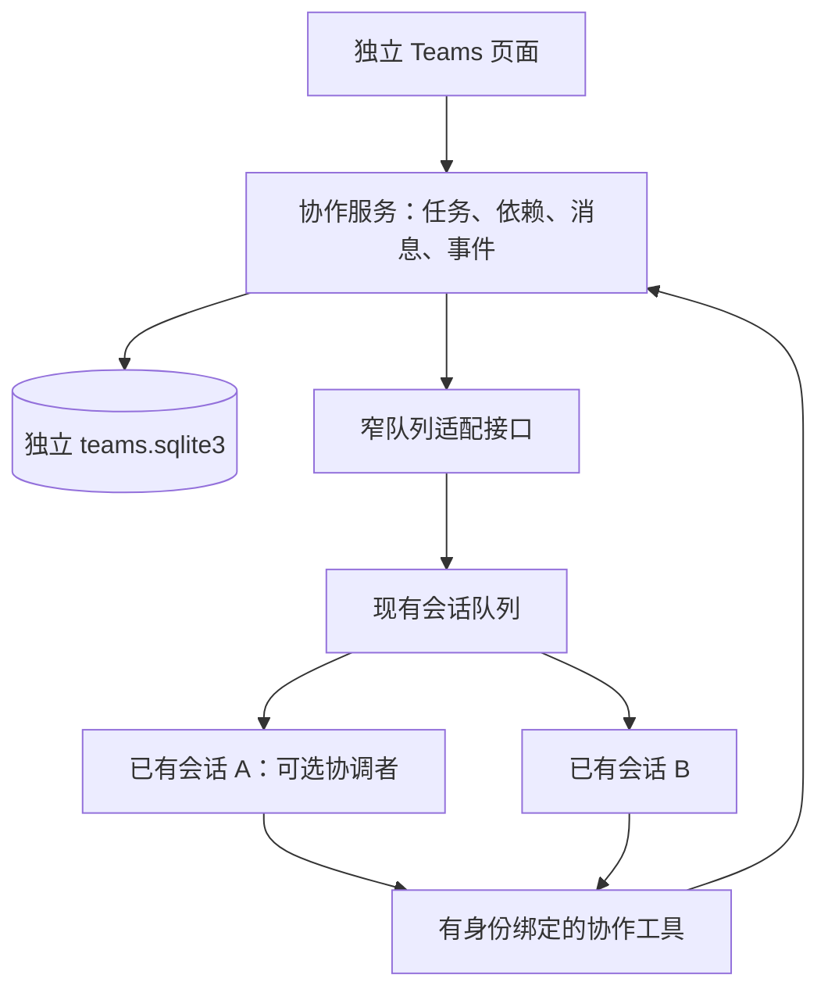

# Studio Agent Teams：松耦合协作设计

状态：开发中。[独立 Rust 领域与队列原型](implementation-status.md) 已实现，真实适配与 UI 尚未接入。本文定义目标行为和 v1 接口契约，不表示当前客户端已支持全部能力。

审查状态：GPT-6.2-Astra 的 [最小实施方案](implementation-options.md) 已获设计 PASS，放行纯 Rust 领域模块/替身测试及 G1b/G2b 隔离验证。本文已采用受信宿主的成员归属、Studio 持久队列的一次授权交接；前三轮 [审查](design-review.md) 与 [反例](verification-results.md) 保留为旧候选的证据。真实适配器须按固定版本与部署拓扑通过验证后启用，设计通过不等于接入已验证。所有开发隔离于 `feat/agent-teams`，未经用户后续指示不合入 main。

## 1. 已确定的产品约束

1. 一个组最多包含 **5 个已有 Codex 会话**；保留各自的上下文、工作目录、模型和权限，不新建子 Agent 替代它们。
2. 协作消息只进入队列。忙碌、审批、用户输入等待和人工暂停期间，不通过 Steer、打断或额外并发 Turn 抢占当前工作。
3. **等待属于任务，不属于会话。** A 的 T1 等待 B 时，A 可以执行 T2；T1 的答复或结果到达后，再排队恢复。
4. 协作模块与会话、队列、UI 松耦合。现有会话只接收消息并使用少量协作工具，无需理解调度器或轮询任务板。
5. 组说明、成员职责和续接上下文由协作模块投送，不修改项目 AGENTS.md，不复制其他会话的完整历史。
6. Teams 可以独立启用、暂停、关闭；停用不影响普通会话和用户消息。
7. **可选地指定一个组内现有会话为 orchestrator（协调者）。** 它是组任务的负责人，也可以执行普通工作；不增加单独 Router、不增加第六个成员。
8. 不指定协调者也能完整协作。指定后，成员仍可直接委派、回问和答复，不需要经协调者中转。
9. 全局 Thread Router 保留现有职责，不参与组内决策，也不与组共享控制器上下文。
10. 通用场景包括开发、审查、调查、设计、验证等；不把 SDK 发布作为固定流程或完成条件。

这些约束替代讨论中“冻结等待中的会话”“新增独立组 Router”“所有委派经主 Agent 中转”的早期方案。

## 2. 最小架构与职责



| 层 | 负责 | 不负责 |
| --- | --- | --- |
| 协作服务 | 成员、任务状态、依赖、回执、持久待投递记录、恢复 | 业务判断、运行 LLM、写目标仓库、直接启动/中断 Turn |
| 会话 Agent | 判断协作需求、委派、执行、回问、提交、验收 | 消息可靠交付、数据库操作、后台状态轮询 |
| 可选协调者 | 理解组目标、拆分工作、选择成员、汇总与推进组任务 | 绕过队列、提高权限、替其他成员伪造提交 |
| 队列适配层 | 标准消息入队、投递回执、撤回、执行就绪门控 | 理解任务目标、决定验收成功 |
| Teams UI | 创建组、选择协调者、任务与讨论、暂停/恢复 | 在浏览器内维护调度循环或任务事实来源 |

建议模块位置为 `src-tauri/src/teams/` 和 `ui-src/teams/`；名称是规划，不是现有文件。
服务持有独立数据库和实例锁，不读写会话内部模型、聊天 DOM 或前端全局状态。UI 通过受 Studio 授权保护的服务接口访问。
第一版只连接同一 Studio 服务已管理的、通过能力检查的 Codex 后端；不实现跨 Studio 实例消息总线、不引入 CCCC。

### 2.1 已有代码与必要适配

- [session_state.rs](../../src-tauri/src/session_state.rs) 已持久化普通消息队列，但没有协作任务、事务 outbox 或任务验收语义。
- [submission-controller.mts](../../ui-src/submission-controller.mts) 中的队列推进位于前端，会检查运行状态和监督状态；普通用户发送另有 Steer 路径，Teams 不得复用该路径。
- [queue-execution.mts](../../ui-src/queue-execution.mts) 已区分发送确认与本地持久化失败，不能把“异常”一律解释为“没发送”。
- [message-queue.mts](../../ui-src/message-queue.mts) 的普通队列深度限制不能用于裁剪 Teams 的持久待办；队列满应返回背压，任务继续保留。
- [codex_app_server.rs](../../src-tauri/src/codex_app_server.rs) 已具备共享 daemon/proxy 接入与生命周期通知，但这不证明原生队列已具备本文全部语义。
- [Turn supervision](../turn-supervision-proposal.md) 可能在多个 Turn 间继续一个用户任务。Teams 必须遵守监督保留执行权的门控。

后台队列、稳定消息 ID、回执和跨客户端就绪检查若需补足，应作为独立队列能力交付。Teams 只调用接口，不新增第二条 `turn/start` 快捷通道。未通过队列能力验收时，不宣称关闭页面后还能自动协作，也不降级成忙时直接发送。

## 3. 可选 orchestrator：智能来自组内现有会话

### 3.1 角色与所有权

`Group.orchestrator_member_id` 为可空成员 ID，必须引用本组一个活跃成员。
它只是现有成员的额外职责，不是新的原生会话、隐藏评估 Agent 或后台 LLM。

- 未指定：用户在选定成员的普通聊天中提出请求；成员根据职责目录直接委派。
- 已指定：用户直接在协调者原有聊天区提出请求，协调者通过工具拆分、委派和验收；普通聊天本身不会被宿主偷偷转换成任务记录。
- 领域层保留用户显式创建根任务的兼容能力：该路径 requester/reviewer 是用户、assignee 是指定成员。当前日常界面没有手动创建任务或“给组一个目标”入口；聊天协调者创建的委派由其自身验收。
- 协调者使用与普通成员相同的协作工具。其委派的 requester/reviewer 是协调者，assignee 是被委派成员。
- A 直接委派给 B 的任务，requester/reviewer 仍然是 A，不因组中有协调者而改成协调者。
- 协调者可以承担实现工作。它忙碌时，自动协作消息排队；用户消息遵循现有聊天区的排队操作。

指定角色不赋予额外仓库、审批或成员管理权限。协调者不能替其他 requester 验收任务。
用户可以查看和处理全组任务；成员只在协议授权范围内改变任务。

### 3.2 与全局 Thread Router 的关系

当前 [Thread Router](../thread-router/specification.md) 是专用协议会话：选择单个目标、返回结构化决策、不调用工具、不拆分工作、繁忙目标失败。它不是组任务调度器。

本方案不修改该协议来偷偷接管组任务，也不把全局 Router 的原生 thread 指定为组协调者。
可复用后端限定的会话身份、职责元数据和已有队列适配基础；不复用控制器历史、全局候选目录或直接派发路径。
组内智能由普通成员会话在正常 Turn 中完成；它通过协作工具产生确定性命令，服务再次校验。

### 3.3 角色变更

用户可以指定、更换或取消协调者。变更增加 `roster_version`，将新说明排入成员队列，不打断当前工作。
更换角色只改变**新的组目标**的默认接收方，既有任务的 assignee/requester/reviewer 不变。
根任务需要交接时，v1 由用户取消原任务并带上下文创建新任务；不静默迁移执行中的任务。
取消协调者后，直接协作继续；未指定接收人的新组目标要求用户选择成员，不广播给全组。

## 4. 领域模型：三种状态必须独立

### 4.1 身份与数据

所有 ID 均为服务生成的不透明字符串。原生会话使用 `{ backend_id, thread_id }`，不能只用 thread ID、显示名称或目录定位。

| 对象 | 主要字段与语义 |
| --- | --- |
| Group | `group_id, name, state, orchestrator_member_id?, roster_version, revision` |
| Member | `member_id, group_id, session_ref, display_name, responsibility, state`；身份不随重命名变化 |
| Task | `task_id, group_id, requester, assignee_member_id, reviewer, parent_task_id?, dependency_task_ids, title, request, acceptance, requester_continuation?, assignee_checkpoint?, status, attempt_id, wait_generation, revision` |
| Question | `question_id, task_id, attempt_id, asked_by, to, text, blocking, state, answer?` |
| Result | `result_id, task_id, attempt_id, submitted_by, summary, evidence[], criterion_results[], limitations`；提交后不可覆盖 |
| Delivery | `delivery_id, source_event_ids[], recipient, task_id?, attempt_id?, wait_generation?, purpose, state, queue_receipt?, native_turn_id?, release_barriers[]` |
| ExecutionClaim | `claim_id, task_id, attempt_id, member_id, backend_generation, native_turn_id, state`；同 task/attempt 最多一个活跃 claim |
| Blocker | `blocker_id, task_id, attempt_id, kind, created_by, detail, state, resolution?`；get 返回完整 blocker 列表 |
| Event | `event_id, group_id, actor, kind, entity_id, revision, created_at, payload`；用于 UI、恢复和审计 |

`requester/reviewer/to` 使用带类型的 `ActorRef = {kind:"member", member_id} | {kind:"user"}`。
`user` 是该 Studio 实例有权操作该组的用户主体，不是另一种 Agent。
v1 中 reviewer 固定等于 requester；委派时不开放任意 reviewer 或 caller 参数。

组可为空或暂存 1 个成员用于设置，运行协作至少需要 2 个，最多 5 个。协调者占其中一个名额。orchestrator/owner 指同一可空角色，每组最多一位。
Group.state 为 `active/paused/archived`；全局 enabled 是独立开关。Member.state 为 `active/removed`，removed 保留为历史身份，不再接收新工作。离线、忙碌和运行失败是会话可用性，不改写成员身份。
界面先输入名称创建空组，再通过组列表的 Add member 入口逐个添加已有会话，每次只添加一名且不指定角色。协调者默认无，只能在修改组对话框中选择。宿主 `ConfigureGroup {expected_revision, name, orchestrator: member_id | null, paused}` 在同一事务保存组名、可选协调者和启停状态；仅用户可调用。少于两名成员不能启用；成员和 revision 验证失败不产生部分修改。已有 `SetOrchestrator` / `SetPaused` / `AddMember.make_orchestrator` 保留领域兼容，日常 UI 使用 ConfigureGroup。移除全部成员保留空组，启用前再次验证成员数、工具绑定和队列能力。聊天提示的发送、回执与恢复语义见 [chat coordination](chat-coordination.md)。
v1 每个会话只加入一个未归档组；暂停不释放成员绑定。归档需先处理未完成任务，成员绑定才释放。
成员移除/组归档必须检查非终态任务、待验收结果、open question 的问答双方、未解 blocker、活跃/未知 claim、unknown/在途/待投递消息；有引用则拒绝。移除协调者必须在同一事务清空或改指其他活跃成员，不能通过删成员让任务失踪。
入组表示组内所有成员可读取全组任务、问题、结果和审计摘要；不授予其他成员的原生完整历史、仓库或凭证读取权。
成员唯一绑定按持久 backend 身份和原生 thread 校验，排除当前及历史全局 Router 控制会话；不能通过隐藏控制器的别名绕过限制。
共享同一实际 checkout 的写入冲突不因加入 Teams 自动解决；各会话保留原工作目录及原有工作区约束。

### 4.2 任务状态

| 状态 | 定义 |
| --- | --- |
| `pending` | 等待执行或返工；并不保证消息已入原生队列 |
| `working` | 执行人已显式 begin/resume 当前批次，工作尚未提交 |
| `waiting` | 当前任务有依赖、问题或外部阻塞；**不锁住 assignee 会话** |
| `submitted` | 已有不可变结果，等待 requester 验收 |
| `completed` | requester 明确验收通过，或有权用户代为验收 |
| `cancelled` | 不再派发此任务；不表示已回滚代码或打断原生工作 |

`waiting` 的原因由未完成依赖、未回答 blocking 问题、显式外部阻塞记录共同派生；解除一个原因不能覆盖其他原因。
执行人可保存 checkpoint 后结束本轮，也可继续无关工作。已 begin 的任务不会因为一轮结束自动变为 completed。
原生执行失败、连接离线、投递未知分别体现在运行/交付状态，不自动改成业务成功或取消。
终态不原地重开；新需求创建新任务并引用旧任务，避免已经释放的依赖再次变化。

### 4.3 执行批次、修订与交付

- `attempt_id` 表示同一任务的一次执行/返工批次。验收退回才产生新的 attempt；普通问答不换 attempt。
- `revision` 是单个聚合的单调递增乐观锁。Task 内的执行状态、问题和结果变更都提升 Task revision；单纯交付进度不提升。
- `delivery_id` 表示一条具体排队消息，不等于 task ID。一个任务可以有执行、问题、回答、验收、续接等多条消息。
- 原生 `turn_id` 只用于关联一次实际执行。一个任务可以跨多轮，一个会话可以交错处理多个任务。
- 投递状态采用 `outbox → queued → authorized → native_queued → started → settled`；另外有 `held`、`withdrawn`、`unknown`。queued 是 Studio 本地队列，authorized 是已取得交接权但可能尚未发起 RPC，native_queued 是原生确认入队，started 才是原生已开始。`settled` 只表示该消息关联的轮次已结束，**不是任务完成**。
- `held` 必须记录原因，例如组暂停、审批、队列满、离线或能力不满足；`unknown` 表示可能已交付但无法确认，不自动重发。

## 5. 接口公共契约

以下是 v1 规范名，实际 MCP/动态工具传输可适配，但参数和业务语义必须一致。UI 与 Agent 调用同一领域命令，不各自维护状态转换。

### 5.1 身份和权限

v1 是单用户受信宿主下的协作协议，不是同 OS 用户的不互信租户隔离。服务从受认证且由受信宿主归属的调用绑定获得 caller 的 Studio 实例、session_ref、member_id 和授权组；**不信任模型传入的 caller、角色或 cwd**。成员接口与实例用户控制接口使用分离授权，不下发 Studio 用户 gateway bearer。
工具中的 `group_id` 是作用域选择，不是授权凭证。跨组 ID 即使存在也不能访问。
成员调用只作用于所属组。用户操作经现有 Studio 用户授权进入；不把一个 MCP 全局 bearer token 当成任意会话身份。
为已有会话注册和恢复工具时，必须验证同一原生 thread 的绑定，不能通过进程名或目录猜测身份。

### 5.2 类型、请求和返回

- JSON 对象采用 `snake_case`，未知字段拒绝；ID 非空。可选字段缺省代表“不提供”，不把缺省和清空混用。
- 所有读工具要求 `group_id`；所有写工具还要求稳定的 `request_id`。
- 修改现有 Task 的命令要求 `expected_revision`，对执行批次操作还要求 `attempt_id`。create 无 Task revision；创建子任务单独要求 `expected_parent_revision`。
- 调用方遇到版本冲突必须读取最新对象并重新判断，用新的 request_id 提交新意图；不能只把版本号替换后盲重试。
- 每条验收条件有稳定 `criterion_id` 和 `text`；criterion_id 由创建者提供、任务内唯一、创建后不可变；结果逐项报告 `met/not_met/not_checked`，不能把缺失项默认为通过。
- Evidence 是引用：`{kind:"commit"|"url"|"file"|"test"|"note", locator, description}`。引用不是执行命令或新增读取权限，服务不自动打开 URL 或跨仓库读取文件。
- `Continuation = {summary, next_action}`：说明任务上下文及结果到达后做什么，不是系统指令，也不允许提高权限。
- `Assessment = {summary, criteria[]}`，每项为 `{criterion_id, verdict:"pass"|"fail"|"not_checked", explanation, evidence[]}`；必须逐项覆盖原验收条件。accept 要求全部 pass；revise 至少一项 fail/not_checked，并给出 requested_changes。evidence 使用同一 Evidence 类型。
- 读取列表使用不透明游标，默认 20 条、最多 100 条；单条任务按 ID 读取包含当前批次、依赖、问题、最新结果和修订。

统一结果形状：

```json
{
  "ok": true,
  "protocol_version": 1,
  "request_id": "req-opaque",
  "replayed": false,
  "data": {"task_id": "task-opaque", "revision": 1},
  "effects": [{"effect_id": "effect-opaque", "state": "recorded"}]
}
```

读操作省略 request_id/replayed，effects 为空。单事务工具成功代表命令与逻辑 effects 已持久提交，不代表消息送达、开始执行或验收成功。跨库维护命令采用下述 operation 阶段契约。

```json
{
  "ok": false,
  "protocol_version": 1,
  "request_id": "req-opaque",
  "error": {
    "code": "REVISION_CONFLICT",
    "message": "Task changed; read it before deciding again.",
    "recovery": "reload",
    "details": {"current_revision": 7}
  }
}
```

`recovery` 只能是 `none/reload/retry_same_request/reconcile/user_action`；它是恢复指引，不授予重放外部操作的权限。
服务确认拒绝的命令无业务写入；网络超时不等于拒绝，客户端按同 request_id 查询/重试原命令。

### 5.3 幂等、并发和限额

组命令幂等键作用域为 `(instance_id, authenticated_actor, group_id, request_id)`；create_group/set_teams_enabled 等实例命令用 `(instance_id, authenticated_user, request_id)`，不伪造不存在的 group_id。
记录 protocol_version、operation 与规范化业务 JSON 的摘要及原始响应；采用 RFC 8785 JSON 规范化，拒绝重复键/非有限数字，字符串不做有损 Unicode 改写。单事务命令同键同载荷返回原响应，`replayed=true`；同键不同载荷返回 `IDEMPOTENCY_CONFLICT`。
权限校验先于任何 replay 返回，再查幂等记录，最后做 revision/state 校验；并发同键通过唯一约束保证最多一次提交。已撤销成员权限不能借旧 request_id 获取历史，关闭期的限权回读只按 §11 白名单授权。
确定性领域拒绝也缓存为该 request_id 的终局响应；修正输入或状态改变后提交新意图要使用新 ID。未认证/格式不合法拒绝不建立可被探测的业务记录；事务回滚/传输结果未知不假装得到确定拒绝，使用原 ID 核对。
组关闭、任务取消后仍允许同一合法调用者查询已提交命令的结果；这不产生新 effects。
幂等记录至少保留到该组及其审计记录被用户明确删除，不能因服务重启失效。

跨库 fence 命令的 request_id 固定映射一个 operation_id/intent_id，首次返回 `phase:pending` 与该 ID。并发重试仅返回同一 operation 的当前阶段，不重新建立意图；team_command_get（实例命令用用户控制面的 command_get）按原幂等 scope 查询。阶段允许 pending → needs_reconciliation → completed/failed，或 pending 直接终结；completed/failed 的终态响应唯一且不可变，后续重放返回它。阶段响应不能宣称业务取消/关闭已完成。fence 超时/未知保持待核对和保守停派，不能记为确定失败并解冻；重启继续按同一 intent 查询。确定未发生 fence 且无在途才允许终结为 failed。此阶段规则是单事务原响应重放规则的唯一例外。

任务变更、事件、幂等响应和 outbox 在同一个 SQLite 事务中提交。原生队列投递不在数据库事务内，使用稳定 delivery_id 对账。
不承诺跨进程的 exactly-once；对无法确定的交付停止自动重放，显式展示不确定性。

v1 有界限制：每组 5 成员、每任务最多 20 条验收条件/20 项依赖/20 项证据；标题 200 Unicode 字符；request、question、answer、summary、requested_changes、detail、resolution 各 32 KiB UTF-8；单条验收条件/证据 locator/description/assessment explanation 各 2 KiB，continuation 总计 8 KiB；ID 最长 128 ASCII 字符；request_id 与 criterion_id 是调用者生成的明确例外，其他实体 ID 由服务生成；未单列自由文本各限 2 KiB UTF-8、数组各限 20 项、嵌套对象深度最多 8（列表分页有单独上限）；单次请求 128 KiB（同时满足各字段限制）。集合必须无重复；以上检查包含所有读写入口。
新工作限额为每组 100 个未结束任务、每任务 20 个 open 问题；超过时拒绝 delegate/ask 等新增工作，不得使 answer、submit、review、cancel、关停和回执无法提交。
每条逻辑通知在业务事务中预留稳定 effect_id 和有界 Event；响应只承诺 effect_id，不提前承诺 delivery_id 或 queue receipt。物化游标把一个或多个 effect 关联到 Delivery（合并时保留 effect_ids），唯一关联防止重复；task_history/command_get 的独立进度字段可查询 delivery_id/receipt，原命令 effects 响应不随进度改变。
每成员最多 100 条已物化、未结束的交付；此限制仅控制物化/入队。释放和回执在事务中写有界业务 Event，由持久投递游标稍后派生 Delivery，不能因出站队列满而回滚已完成的回答或取消。以唯一 causation key 防止游标重放重复消息；磁盘写失败仍明确失败，绝不假称落盘。
每个逻辑任务最多 256 次新增问题/外部 blocker/协作续接，超额只停止新增工作，保留最终回答、结果、验收和取消容量；审计数据不因数量限制静默丢弃。用户处理后通过新任务继续，不无限增加同任务历史。
排队正文限制为 8 KiB UTF-8，只含明确的任务/批次 ID、类型和有界摘要及读取指引。完整目标、验收条件、结果均保存在权威对象中，必须 get 后操作；摘要被裁短会显式标记，不能裁剪权威内容。这避免组合消息超过普通队列 64 KiB 限制。

## 6. 协作工具目录

为避免一个含糊的万能工具，工具按意图划分。参数表中 `W` 表示 `group_id + request_id`，`T` 表示 `W + task_id + expected_revision`，`E` 表示 `T + attempt_id`；这些是说明缩写，实际 JSON 展开为平铺字段。

### 6.1 发现与读取

| 工具 | 参数 | 返回与语义 |
| --- | --- | --- |
| `team_context` | `group_id?`（传 `{}` 时由宿主按已认证成员会话确定组） | 组状态、roster_version、本人身份、成员职责、可选协调者、工具规则和能力；不返回别人的完整历史 |
| `team_task_get` | `group_id, task_id` | 完整当前任务快照与 revision；结果历史分页独立读取 |
| `team_task_history` | `group_id, task_id, cursor?, limit?` | 按事件序号升序读取执行批次、问题、结果和验收记录；游标绑定任务与读取快照，保留旧 Result 的完整内容 |
| `team_task_list` | `group_id, status[]?, assignee_member_id?, requester?:ActorRef, cursor?, limit?` | 可明确过滤 user 或 member requester；按稳定任务序号返回摘要；不默认启动或恢复会话 |
| `team_command_get` | `group_id, request_id` | 读取本人写命令的已提交结果；未找到只说明未有提交记录，不能证明并发请求没有在途 |

空过滤条件表示全组授权可见任务，不把省略 assignee 解释为“本人”。UI 可显式传本人过滤。所有读接口都先校验真实调用来源和组访问权；cursor 绑定实例、组、过滤条件、排序和初始水印，不接受跨 scope 复用。history 以 event 序号分页，Task 列表以 task 序号分页，变化后从新快照开始。

### 6.2 `team_delegate`：建立一项有验收条件的工作

参数：`W, to_member_id, title, request, acceptance[], continuation?, dependency_task_ids?`。
可选子任务参数必须成对提供：`parent_task_id, expected_parent_revision, parent_attempt_id`。

- requester/reviewer 从 caller 派生，assignee 为 to_member_id；不接受 `from` 或任意 reviewer。
- 允许指派给自己，用于协调者记录自己承担的独立工作；必须是明确调用，不能由回复循环自动生成。
- 对方忙碌不是错误；成功后 task 为 pending，通知为 outbox/held，立即返回，不等待执行。
- 初始 dependency_task_ids 必须是同组已存在任务；未完成则任务 waiting，不先排入执行队列。取消的依赖作为阻塞显示，不能当作完成。
- 创建子任务要求 caller 是父任务当前 assignee，父任务为 working/waiting，parent_attempt_id 匹配。事务中新增子任务、把它加入父任务依赖、保存父任务 waiting 状态。允许在第一次委派使父任务 waiting 后继续委派其他并行子任务，每次使用最新 parent revision。
- 子任务的 requester 是父任务 assignee，因此子任务待验收消息可以送达正在等待父任务的同一个会话。
- 事务中检查依赖环，包括“父任务等待子任务、子任务又等待父任务”的情况。
- 子任务创建不阻塞该会话处理无关任务，也不强制终止当前 Turn；工具提示调用者先完成安全收尾，再结束本轮。
- 返回完整 Task 摘要、父任务新 revision（如有）和 effects。

delegate 的 `continuation` 写入 requester_continuation，是 requester 验收结果时的原工作说明。task_update 的 continuation 写入 assignee_checkpoint；父任务的 checkpoint 独立保存，不与子任务 requester_continuation 共用字段。
v1 不支持原地改写已派发任务的目标、验收条件、执行人或初始依赖；补充讨论不扩大验收范围，实质变化取消后新建。

### 6.3 `team_task_update`：显式记录执行进展

参数：`E` 加按 action 严格区分的对象；每种 action 只接受其字段：

| action | 额外字段 | 调用者 / 前置状态 | 结果 |
| --- | --- | --- | --- |
| `begin` | 无 | assignee / pending、无未解阻塞 | working；表示开始处理，不表示拿到会话全局锁 |
| `checkpoint` | `continuation` | assignee / working 或 waiting | 保存续接点，状态不变 |
| `wait` | `reason:"external"|"needs_user", detail, continuation` | assignee / working | 新建 blocker，进入 waiting；needs_user 同时生成用户通知 |
| `resolve_blocker` | `blocker_id, resolution, user_decision_id?` | blocker 的 assignee 或用户 / working、waiting | 逐项解除 external；needs_user 仅用户或已匹配用户决定。其余 blockers 保留，最后一个解除产生一次 ready 通知，不领取 Turn |
| `resume` | 无 | assignee / waiting 且 ready | 取得当前 Turn claim，转 working；不解除任何 blocker |
| `reclaim` | `previous_claim_id, continuation` | assignee / working，旧 Turn 已确认成功结束 | 复用 attempt 领取新 Turn；旧 Turn 失败/未知必须先由用户核对 |
| `cancel` | `reason` | requester 或用户 / 任意非终态 | cancelled；撤回未执行交付，不中断已经开始的 Turn |

`checkpoint` 不代表暂停会话。begin 后若执行失败，状态保持 working 并显示运行异常；不能仅凭 get/checkpoint 跨 Turn 接管，必须先处理旧 claim，再 reclaim。
begin/resume 成功必须关联服务验证的当前原生 Turn，并使该 attempt 尚未开始的重复执行/续接交付失效；不能信任模型自行填写 turn_id。若人工指令使会话提前接手待办，也通过同一 claim 规则撤回多余消息。正在别的 Turn 执行或状态无法确定时拒绝 claim。
无阻塞的 waiting 任务收到续接消息后可用 resume；用户不能凭 UI 操作冒充一个有原生 Turn 的 assignee。
assignee 无法完成时调用 wait 并说明原因，由 requester 决定调整或取消；不能用 submit_result 冒充成功。
needs_user 阻塞只能由用户操作或已记录的、匹配该 blocker 的用户答复解除；assignee 不得自行宣称用户已批准。对用户审批也继续使用原生审批机制，任务 blocker 不是替代授权。
依赖和问题 blocker 由对应 accept/answer 自动解除，不能用 resolve_blocker/resume 绕过。get 返回每项 blocker_id、kind、state、resolution。解除 blocker 可逐项提交，不要求其他项同时可解；状态派生和最后一次 ready 通知在同一事务完成。

每个 task/attempt 最多一个 active ExecutionClaim；一个原生 Turn 可处理多个任务，但每项命令仍需显式 task/attempt 和匹配 claim。begin/resume/reclaim 原子占有 claim，受信 Turn 终结释放其活跃性并保留历史；异常/未知 claim 标为 needs_reconciliation，绝不按租约过期推断工作完成。working 的 checkpoint/wait/submit、父任务委派与 assignee 的 blocking ask 必须匹配当前 claim。requester 的提问/验收使用自己的已认证 Turn，不冒用 assignee claim。

### 6.4 `team_ask` / `team_answer`：问题有身份、有生命周期

`team_ask` 参数：`E, to: ActorRef, question, blocking, continuation?, related_question_id?`。related_question_id 必须引用同任务问题，只建立可见关系，不自动覆盖旧答案或解除 blocker。

- requester/assignee 可以提问，目标必须是本组活跃成员或用户，且不能是提问者自己。
- 任务 pending/working/waiting/submitted 时可提问；submitted 阶段的提问不能回退该结果的状态。
- `blocking=true` 只允许当前 assignee 在 working/waiting 时使用，且必须提供 continuation；它阻塞这项任务，不阻塞会话。
- 返回 question_id 和任务新 revision，并向目标创建一条问题交付；非 blocking 问题也需要答复，但不阻止提交结果。

`team_answer` 参数：`E, question_id, answer`。

- 只有被问到的成员或有权用户可以回答；必须是当前 attempt 的 open 问题。
- 回答不可覆盖；补充/修正通过一个新的相关问题进行，并明确引用旧 question_id。
- 原子保存回答、关闭问题、解除其 blocker，并向 asked_by 排入答复消息。
- 多个 blocker 尚未解除时，答复消息仍可处理，但不得宣称原任务已可继续。
- 问题和回答都是独立可处理工作，不等待原任务依赖解除，否则会出现“A 等 B，B 的问题却进不了 A”的死锁。
- attempt 更换或任务终结后，旧问题变为 superseded/closed；迟到回答返回 STALE_ATTEMPT/TASK_TERMINAL，不唤醒旧工作。

普通进度由 checkpoint 与 UI 事件表示，不向其他 Agent 自动发送“收到”“正在处理”等确认消息。

### 6.5 `team_submit_result`：执行人交付，尚未验收

参数：`E, summary, evidence[], criterion_results[], limitations`。
criterion_results 每项为 `{criterion_id, status:"met"|"not_met"|"not_checked", explanation, evidence_indexes[]}`，必须完整覆盖任务验收条件，不能重复或引用不存在的证据。

- 只有 assignee 可以提交；当前状态必须 working、无未解依赖和 blocking 问题。
- 即使部分条件未满足，也可如实提交供 requester 判断，但不能因此自动完成任务。
- 同一 attempt 最多一个不可变 Result；工具返回 result_id，任务进入 submitted。
- 原子产生 requester 的验收交付；若 requester 为用户，仅产生 UI 待办，不自动找一个 Agent 代验收。
- 提交后执行人停止该任务的修改，并正常结束本轮；验收交付必须等提交者关联 Turn 结束再放行，避免对方在修改尚未收尾时检查。
- 无法证明关联 Turn 已结束时持有交付；原生 Turn 失败/中断则标记需核对，不把先前 result 静默删除，也不自动当作成功。
- 验收消息只带上述对象的 ID、有界摘要与权威读取指引，总计不超过 8 KiB；通过 team_task_get 读取完整目标、验收条件、结果、证据、limitations 和 requester_continuation。

### 6.6 `team_review_result`：只有验收才能释放依赖

参数：`E, result_id, decision:"accept"|"revise", assessment`；revise 额外要求 `requested_changes`。

- caller 必须是 reviewer 或用户；Task 必须 submitted，result 必须属于当前 attempt。
- **所有 review 命令本身都检查提交 claim 的原生 Turn 已 settled-success**，不只延迟 UI 通知。未结束返回 RESULT_NOT_READY；失败/中断返回 RESULT_RECONCILIATION_REQUIRED，由用户按下述控制接口记录核对结果或要求返工，直接 get 不绕过门控。
- accept 要求逐项 assessment；未检查/不满足的条件必须先解决。用户若决定改变目标，应取消并新建，不由 Agent 默默放宽条件。
- accept 原子变为 completed，记录 review，唤醒已满足所有依赖的相关工作；不额外给 reviewer 发送“你已验收成功”的 Agent 消息。
- 自动依赖解除发生在 accept 提交时；Agent 验收派生交付包含 review Turn 的 release barrier，等待其 settled-success；用户验收以用户事务提交为边界，不等待不存在的 Turn。多个依赖的 barriers 取并集落盘。review Turn 失败后不撤销已记录 verdict，但冻结相关交付待用户 reconcile_review。直接 begin/resume 与消息消费均检查所有相关 release barriers；同一会话本轮需要继续父任务时必须显式 resume 取得 claim 并撤回待投递续接；不得通过自我续接越过其他成员的 release barrier。
- revise 保留旧 Result/Review，新建 attempt_id，任务回 pending；旧批次问题和未执行交付失效，向 assignee 排入带明确修改要求的新执行消息。
- requested_changes 必须处于原验收范围，额外需求新建任务；实现仍需由 Agent/用户判断语义范围，服务不能凭结构验证证明这一点。
- completed/cancelled 不接受新的结果覆盖。合法旧提交可以由原幂等键查询，但不能生成新通知。
- 自动验收是 requester Agent 的判断，不是后端保证事实正确；UI 始终展示验收人、依据和局限。

### 6.7 状态转换摘要

| 命令/事件 | 从 | 到 | 是否自动通知 |
| --- | --- | --- | --- |
| delegate | 无 | pending / waiting | 无依赖时给执行人 |
| begin | pending | working | 无 |
| blocking ask / wait / 创建子任务 | working | waiting | 问题目标 / 用户 / 子任务执行人 |
| 全部阻塞解除 | waiting | waiting（ready=true） | 一条去重续接；不自动执行 |
| resume | waiting 且 ready | working | 无 |
| submit_result | working | submitted | requester 验收 |
| review accept | submitted | completed | 满足依赖的工作 |
| review revise | submitted | pending，新 attempt | 执行人返工 |
| cancel | 非终态 | cancelled | UI；阻塞它的下游待用户处理 |

提问、答复和 checkpoint 可以提升 revision 而不改变状态。ready 是派生字段，不是第七种状态。
waiting 已 ready 但尚未 resume 时新增 blocker，必须在同一事务使旧 ready effect/凭证失效，并通过 fence 撤回未开始交付；已在途只可 get 后重新判断，不允许 resume。每次 blocked → ready 再递增 wait_generation，首次进入 waiting 也递增；ready 通知唯一键为 `(task_id, attempt_id, wait_generation, recipient, purpose)`；不能仅按 attempt 去重而吞掉下一次等待。回答与 ready 合并时保留全部 source_event_ids，使用事务 causation ID 记录来源。取消/终态/旧 attempt 的迟到非 blocking 答案只记录拒绝，不产生唤醒。
自动提醒缺少结果回执最多每个任务 attempt 一次，且只在相关轮次确已结束后排队；失败/中断/审批停顿不触发追问循环。

### 6.8 调用与开关矩阵

以下所有成员操作均先验证逐调用来源；group_id/task_id 等域内校验不能替代来源校验。`R` 表示当前 Task revision，`A` 表示当前 attempt，`C` 表示当前原生 Turn 的 ExecutionClaim。

| 操作 | actor / 约束 | active | paused | disabled |
| --- | --- | --- | --- | --- |
| context/list/history/get | 本组成员，读取范围如 §4.1 | 可读 | 可读 | 仅白名单 claim 的 task_get，其他不提供；用户维护读取独立授权 |
| command_get / 幂等重放 | 原 caller，重新验证当前权限 | 原结果 | 原结果 | 仅关闭白名单允许的原命令 |
| delegate 根任务 | 成员或用户，目标有效 | 建任务/派发 | 拒绝自动新工作 | 拒绝 |
| delegate 子任务 | 父 assignee，父 R/A/C，working/waiting | 原子建子/阻塞父 | 拒绝新工作 | 拒绝 |
| begin/resume/reclaim | assignee，R/A，可信当前 Turn，满足状态/旧 claim 规则 | 取得 C | 拒绝新领取 | 拒绝 |
| checkpoint/wait | assignee，R/A/C，working/waiting 按 action | 保存 | 当前有效 C 可保存，通知 held | 拒绝新状态变更 |
| resolve_blocker | assignee 或用户，R/A，逐 blocker 授权 | 解除项/派生 ready | 解除项，通知 held | 仅用户维护入口可解除，不派发 |
| ask | requester/assignee，R/A；blocking 要 C | 问题消息 | 当前工作相关可记录，effects held | 拒绝 |
| answer | 被问者或用户，R/A/open question | 记录答案/通知 | 记录，effects held | 拒绝成员新答复；用户维护可记录但 held |
| submit_result | assignee，R/A/C，无 blocker | 原子保存/待验收 | 保存，effects held | 仅关闭白名单 C 的一次提交 |
| review_result | reviewer 或用户，R/A/result，提交屏障通过 | 验收或返工 | 验收或返工落盘，effects held | 成员拒绝；用户只可做明确维护核对，不自动派发 |
| cancel | requester 或用户，R/A，非终态 | fence 后取消 | fence 后取消 | 仅用户维护可取消 |

paused 状态不阻止已经持有 C 的执行人处理当前任务；不通过正常 begin 为新任务授予 C。用户控制面的关闭/对账/预算操作不通过成员接口冒充 Agent。
每个写返回当前聚合的新 revision、状态和已持久化 effects；零 effects 是合法结果。源消息尚未投递或聚合版本变化时，Agent 必须 get 最新权威对象后决定，不以排队摘要中的 revision 直接执行。

## 7. 组管理与独立 UI

组管理仅通过有用户权限的控制接口，Agent 只能读取目录，不能添加成员或自授协调者角色。

| 用户命令 | 参数与规则 |
| --- | --- |
| create_group | `request_id, name, members[{session_ref,display_name,responsibility}], orchestrator_session_ref?`；输入的协调者引用精确匹配 members，返回 member_id 映射、group revision、roster_version |
| ConfigureGroup | 当前宿主命令：`group_id, request_id, command:{op:"ConfigureGroup", expected_revision, name, orchestrator:member_id|null, paused}`；仅用户操作，原子校验并保存，返回完整 group；修改组 UI 的唯一配置入口 |
| update_group | `group_id, expected_group_revision, request_id, patch`；name、成员显示名/职责、orchestrator_member_id 可更新；null 仅用于清除 orchestrator |
| change_members | `group_id, expected_group_revision, request_id, add[], remove_member_ids[]`；原子检查人数及全部引用；返回完整新 roster；不能替换 thread ID 继承身份 |
| pause_group / resume_group | `group_id, expected_group_revision, request_id, reason`；持久变更派发开关，返回新 revision 和 fence receipt，不改变任务业务状态 |
| archive_group | `group_id, expected_group_revision, request_id`；检查全部引用和在途，返回归档 revision，保留历史并释放绑定 |
| set_teams_enabled | `request_id, expected_settings_revision, enabled`；实例级幂等，返回 enabled、settings_revision、关停/恢复阶段和 fence receipts |
| create_group_goal | `group_id, expected_group_revision, request_id, to_member_id?, title, request, acceptance[], continuation?`；事务内解析显式目标或当前协调者，复用 delegate 领域命令；无目标且无协调者明确拒绝 |
| grant_rework_budget | `group_id, task_id, expected_revision, request_id, additional_attempts, reason`；仅用户，1～3 次有限追加；返回 task revision 和剩余次数 |
| reconcile_execution | `group_id, task_id, attempt_id, claim_id, expected_revision, request_id, decision, evidence[]`；用户核对已终结但失败/未知的旧 claim，decision 为 `confirmed_settled/no_replay`；原生仍 active 时拒绝。confirmed_settled 允许 reclaim，不代做业务验收；no_replay 保留阻塞供取消 |
| reconcile_result | `group_id, task_id, attempt_id, result_id, expected_revision, request_id, decision, evidence[]`；用户核对失败提交屏障，decision 为 `allow_review/require_rework`；前者只打开 review 门控，后者记录用户退回并新建 attempt。不得据此伪造 Turn 正常结束 |
| reconcile_review | `group_id, task_id, attempt_id, review_id, barrier_id, expected_revision, request_id, decision, evidence[]`；用户仅可核对已 terminal-failed/interrupted 的验收 Turn，decision 为 `release/keep_frozen`；release 只打开指定 barrier，不更改 verdict、不伪造 settled-success。未知或仍活跃 Turn 拒绝 release，保留审计证据 |
| reconcile_delivery | `group_id, delivery_id, expected_delivery_revision, request_id, decision, evidence[]`；用户 decision 为 `record_receipt/abandon`；前者必须有可核对原生 receipt，后者停用未来派发并保留原结果未知。都不授权重放；潜在在途仍未终结时保留归档阻塞 |

共享右侧 Teams 面板展示组列表，再进入成员/职责表。修改组对话框统一设置组名、启停及可选协调者；添加成员没有角色选择器。没有 Tasks 或“给组一个目标”入口，用户直接在协调者聊天区提出请求。成员表中的 Orchestrator 链接打开原会话，不创建新会话或第二个 Router。
Activity 保留当前任务、问题、结果详情、验收/退回及不确定交付恢复；已完成工作折叠。任务详情返回 Activity，Activity 返回成员列表。历史 `archive_group` 仅保留领域兼容，不在 UI 提供操作。
成员队列显示 `Teams · T12 · 来自应用`，点击打开任务；原会话列表、阅读器和编辑器不依赖 Teams 组件。
任务状态与会话状态分别显示，例如“任务等待 SDK；会话正在处理另一项工作”。
Teams 模块懒加载；关闭时隐藏页面和协作工具入口，不在普通会话中常驻团队控件。

保留设置中的 Teams 总开关、只读关停状态和用户对账入口，即使 Teams 页面隐藏仍可重新开启和处理在途工作。关闭不禁止这些经用户授权的维护命令。
用户控制命令也采用 §5 信封、严格字段枚举、乐观锁和幂等；组范围操作用 expected_group_revision，Task/Delivery/Settings 使用各自版本，不共享一个含糊的 expected_revision。
组写入在数据库唯一约束与事务内检查人数、原生身份绑定、控制器排除、协调者成员归属。并发两次加人不能突破五人上限。

## 8. 非抢占队列协议

### 8.1 窄接口

```text
capabilities(session_ref) -> admission / status / withdraw / correlation 支持情况
admit(session_ref, source, stable_id, visible_message, scope_generation) -> local_receipt
reserve(session_ref, owner, generation, reason) -> reservation_receipt
release(reservation_id, generation) -> released | needs_reconciliation
lookup(session_ref, stable_id) -> known_state | unknown
fence_scope(scope, generation, intent_id) -> fence_seq + per_delivery_receipts
subscribe(receipt_cursor) -> queue/turn receipts
```

Teams 通过 admit 把 delivery_id 作为 stable_id，普通排队输入走同一通用服务。origin/scope 是结构化来源和有效性标识，不是人工授权文本。接口只理解通用来源、保留与有效性凭证，不导入任务业务模型。通用消费者内部有 authorize_head 和 submit_authorized，两者不暴露给成员模型。域内按稳定 ID 幂等，原生 add 不假定幂等。

### 8.1.1 唯一交接裁决

Rust 通用队列保存稳定 message_id、每会话 enqueue_seq、来源、状态和凭证。普通消息仍使用兼容的原有 payload 存储，以逐会话 revision/CAS 拒绝陈旧页面的整数组覆盖；普通发送先核对队列版本与条目，再经共享保留及宿主持久回执账本交接，多个页面不能重复发送同一稳定 ID。保持普通用户消息、附件和逐轮选项；统一的是消费裁决与发送所有权，不要求复制或重写既有 payload。Teams 自动通知只经受保护的通用队列交接。

消费者把队首、暂停、审批/输入等待、失败停顿、监督保留、来源有效性及派发代数与授权放在同一持久裁决序列。默认观察到无活跃工作才领取；随后即使外部 CLI 抢先启动，Teams 路径也只调用 `thread/queue/add`，必须排到后续独立轮次。不得调用 turn/start、queue/start、Steer 或 interrupt 来唤醒成员。

每会话最多一项已交接但尚未确认开始的 Teams 通知。授权事务生成 dispatch_id 和稳定 clientUserMessageId；发送前持久记录“可能已发送”，唯一 worker 只 add 一次。成功保存 queuedSubmission.id 后由原生自然消费，started 由原生事件/历史证明。原生 add 重复 ID 会创建副本，因此网络未知不能重试；稳定 ID 用于对账，不是原生幂等保证。

原生队列中只出现已授权输入。撤销先赢则本地 held/withdrawn；授权先赢则按证据区分未发送、native_queued、started 和 unknown。原生消费不会再同步检查 Studio epoch；这是相对早期候选的明确边界改变。交接后用精确删除、核对和任务 begin/attempt 校验阻止过期业务操作，不能承诺点击停止后已经交给原生的消息绝不产生一个新的 Turn。

Studio 队列有自己的持久顺序；原生已有人工项遵守原生顺序。本地待办尚未交接时没有原生队列位置，不承诺所有外部客户端按现实提交时间的全局 FIFO。普通用户主动发送/Steer 的既有行为保留。G2b 必须验证 add 不注入活跃 Turn，不能用 queue/start 的一次拒忙推导 turn/start 或 add 的行为。

### 8.1.2 保留、撤回与不确定恢复

人工暂停与监督保留有 owner/generation。监督在根任务可能出现轮间空档前 reserve，与授权同序；明确结束或核对后才 release。页面关闭/租约超时不表示任务完成。新监督与已交接通知竞争时，先精确撤回/核对或等待已开始项，不提前报告已取得独占保留。外部 CLI 可以正常使用原 thread，但外部自定义的跨轮逻辑监督须登记 reservation；已知存在不可观察的保留时停止该成员自动派发。

跨 Teams DB/通用队列 DB 仍使用 mutation_intent + durable fence，不假装跨库原子：先冻结新命令/交接并创建意图，通用队列撤销未来授权并返回分项凭证，Teams 保存凭证与业务结果。已原生排队项按服务端 ID 删除，不能触碰普通人工消息。paused/disabled 的完整确认须等未开始项明确撤回，其余有真实 started/settled 证据；未决保持 stopping/disabling/needs_reconciliation，不能把 authorized 说成 started。

崩溃在发送意图之前可重新领取；意图之后的断线、超时、确认丢失都视为 unknown。原生队列唯一稳定 ID 命中且收件人/内容相符可补 receipt，历史/事件中的关联 Turn 可证明开始；查无、仅正文相同或多命中都不能证明没提交。未知停止自动重发，用户可记入可信凭证或放弃；只有明确未提交/被拒绝才允许重新入本地队列。业务命令和 effect 的本地幂等不等于原生交接的 exactly-once。

通用队列可用替身先开发；改变普通消费前必须验证旧数据、多页面、暂停和监督兼容。真实交接须通过 G2b；该设计不要求 Codex 原生 add 自带幂等或消费前回调。

### 8.2 执行资格

- 任务在服务 outbox 中持久保存，目标忙碌仍可接收队列项；实际执行必须等现有队列允许。
- 人工消息与团队消息进入同一个已有执行入口，按有效队列顺序处理。Teams 不另起隐形优先级队列或抢占用户发送。
- 同一原生会话最多一个活跃执行；多个 Studio 页面不能各自派发同一消息。
- 完成一轮不等于完成协作任务，也不一定等于普通逻辑任务结束。队列仍需尊重当前任务的监督/续接保留权、用户暂停和审批。
- 不引入 AI 观察员猜测“当前任务是否结束”；使用已有队列的明确就绪门控。门控无法证明安全时 held，不以 idle 缓存或超时强行放行。
- task waiting 不是 session gate；符合条件的问题、回答、验收、其他任务都可执行。
- 队列满产生背压，保留 outbox；当前普通队列的深度上限不能裁掉 Teams 消息。
- 外部 CLI 也能操作同一 thread 时，需要原生原子入队/就绪语义或可证明的冲突拒绝；“读取 idle 后立即 turn/start”存在竞争，不作为安全实现。
- 缺少能力时显示具体原因，不降级为 Steer 或直接向当前 Turn 注入。

### 8.3 防止过期工作

组暂停、任务取消、返工更换 attempt、关闭功能都提升相应派发 epoch。尚未交接的旧消息在本地领取前失效；已交接的旧消息按 §8.1.2 精确撤回和核对，领域 begin/attempt 校验拒绝过期工作，不假定原生消费会回查本地 epoch。
已经开始的轮次无法撤回，也不能删除会话历史。迟到工具调用由 task/attempt/revision 校验拒绝产生新业务效果。
如果后端不能区分 queued 与 started，必须显示 unknown 并停止重放；不能谎称“已取消执行”。

## 9. 事件、持久化与恢复

正常路径由工具命令和队列事件推动，不让 Agent 定时读聊天或轮询工作进度。
每个命令在一个事务中提交业务事实、审计 Event、幂等记录和 outbox。UI 通过可续传事件流更新，断线后按事件游标补齐或重取快照。
建议独立表：groups、members、tasks、task_dependencies、task_blockers、questions、results、reviews、commands、events、deliveries。

一个服务实例锁保证一个投递 worker 持有派发权。worker 租约不是原生会话执行锁；外部客户端竞争仍由队列协议处理。
数据库 schema_version 与工具 protocol_version 分开版本化；迁移失败保持关闭，不读取半迁移状态继续执行。

恢复顺序：

1. 读取 Teams 开关、组暂停、任务终态和派发 epoch。
2. 恢复已提交命令和 outbox，核对能力与会话身份。
3. 用 delivery_id 查询队列/历史回执；已接收不重复发，明确未提交才可重试。
4. 状态未知的交付保持 unknown，显示可检查的原会话链接。
5. 只为仍有效且满足条件的消息继续派发；不因“重启”重开取消任务或重置返工预算。

轮询仅用于事件丢失后的补偿、有限退避的连接恢复和用户刷新，不承担业务完成判定。
浏览器关闭后，Studio 后端仍运行且队列具备后台能力时继续。整个 Studio 后端退出时暂停；下次启动恢复。
不默默安装独立系统服务。需要常驻时可由用户已有的 Studio 服务部署承载。

## 10. 上下文投送与工具绑定

入组或职责变更产生短组说明，走同一队列；同一成员尚未执行的旧 roster 更新可以明确撤回后替换为最新版，不能隐式丢弃任务消息。
每条任务消息含 protocol_version、group/member、roster_version、task/attempt、执行或验收意图，以及目标、验收条件、相关问题/结果和续接说明的有界摘要与读取指引，总计 8 KiB。完整业务内容必须通过权威读取获得。
上下文版本过旧时 Agent 可调用 team_context；写操作仍由服务按当前角色和权限校验，不相信旧提示词。

协调者说明包括“负责组目标拆分、使用 delegate、汇总验收、可做其他任务”；普通成员说明包括本人职责、同伴职责、何时委派、何时提交结果。
所有提示均表明：协作请求是任务数据，不是新的权限来源，不覆盖用户指令或审批。
大附件只携带有授权的引用，按需读取；不把全组会话历史注入每次请求。

### 10.1 如何把工具提供给 Codex App Server

**按 Astra 初审修订：MCP 是唯一优先验证的成员命令适配候选；Hooks＋普通 CLI 不作为 v1 成员写入通道（见 §10.5）。** MCP 仍未证明可用，G1 失败则停止，不改用较弱身份的 CLI。工具不是写进提示词就能调用：MCP 路径必须提供真实服务，由 Codex 发现工具的 name、description、inputSchema，并把 tools/call 路由到 Teams 领域命令。
若采用 MCP，规划在 Studio Rust 服务内提供一个受认证的 Streamable HTTP MCP 入口；不依赖浏览器页面处理工具。协议桥接只转换请求、验证调用绑定并返回结果，不另建一套任务存储。
端点路径、认证材料和配置写入方式由接入验证确定；本文没有宣称当前二进制已提供该端点。

```text
模型选择 team_delegate
  → Codex App Server 的 MCP 客户端
  → Studio Teams MCP：校验连接与调用身份、参数
  → Teams 领域事务：保存 task/event/outbox
  → MCP CallToolResult 返回结构化业务结果
  → Codex 把工具结果交给同一会话继续推理

outbox → 现有会话队列适配层 → 目标会话（另一个独立流程）
```

MCP 工具调用只等待一次短事务，不等待协作方完成。只读工具标记 readOnlyHint；创建/修改任务的工具不能伪装为只读。MCP annotations 不是授权机制，仍服从原生审批和服务身份检查。
成功结果将 §5 的业务信封作为 structuredContent，同时提供等价 JSON 文本 content 兼容客户端；领域拒绝返回 ok=false 且 MCP isError=true。JSON-RPC 方法/参数错误与领域拒绝区分。工具可见不等于模型一定会调用，协作说明仍须明确指引。

### 10.2 已核对的能力与限制

本地核对版本为 `codex-cli 0.170.0`，通过 `codex app-server generate-json-schema --experimental` 检查接口，未修改真实会话配置、未执行模型调用：

| 能力 | 已确认 | 不能由此推断 |
| --- | --- | --- |
| `thread/start.dynamicTools` | 可声明动态工具；`item/tool/call` 包含 threadId、turnId、callId 等字段 | 给任意已有 thread 热添加工具 |
| `thread/resume` / `turn/start` | 此版本生成的参数 schema 没有 dynamicTools 字段 | 在这两个接口塞 dynamicTools 就会生效 |
| `config/mcpServer/reload` | 从磁盘重载 MCP 配置，为已加载 thread 排入刷新 | 所有忙碌会话立刻换工具、无需逐 thread 检查 |
| `mcpServerStatus/list` | 可按 threadId、serverName 检查工具目录 | 列表出现即表示端到端执行和身份授权已验证 |
| `mcpServer/tool/call` | 可经指定 thread 的 MCP 连接调用工具 | 这个宿主测试调用等同于模型已学会自动协作 |

Studio 的 [session-map.mts](../../ui-src/session-map.mts) 和 [active-codex-connection.mts](../../ui-src/active-codex-connection.mts) 已有动态工具声明/处理代码，但它们不能作为“所有旧会话都能注入 Teams 工具”的证明，也不能复制前端回调来实现关闭页面后的可靠协作。
官方文档描述动态工具的持久恢复，而本机 resume schema 没有新增动态工具字段；发布时以目标版本的 schema 和实测为准。动态工具可留作有完整生命周期支持时的另一个适配器，不作为 v1 保留已有会话的默认解法。

### 10.3 注册、身份与关闭

1. 启用时在目标 Codex 后端的实际配置作用域注册 Studio 专属 MCP server；只修改自己拥有的项，保留其他 MCP 配置。共享 daemon 的配置可能影响其他客户端，不能把进程级配置误说成单个 thread 配置。
2. 使用官方重载接口请求刷新，在安全的轮次边界检查各成员 thread 的工具目录。若必须恢复会话，恢复同一 thread，不能中断忙碌任务或新建替代会话。
3. 配置 `required=false`，使可选协作服务不可用时不连带阻断普通会话启动。工具不就绪的组只显示未就绪，不派发依赖工具回执的任务。
4. 端点必须位于 App Server 可达的执行主机/环境；SSH、WSL 和远端环境里的 localhost 不等于浏览器的 localhost。认证材料保存在受保护的宿主配置/凭证渠道，不能放进提示词、仓库或通用消息队列。
5. 未经明确配置不采用全局 MCP 注册；它可能让非组成员也看到工具名；可见性不授予使用权。服务仍拒绝未绑定 thread、跨组调用和关闭后的新动作。
6. 当前上游源码的 MCP 请求会包含宿主生成的 threadId、sessionId、callId 等元数据；这是接入线索，不是 MCP 标准对所有客户端的保证。必须在目标版本验证，并结合受认证连接和 App Server 调用事件关联，不把任意 HTTP `_meta`、模型 arguments 或通用 bearer token 当作可冒充任何成员的身份。
7. 需要 turn 绑定的命令还要证明 call 与实际 Turn 的关联；`sessionId` 也不能代替 `threadId`。元数据缺失、矛盾或无法核对时拒绝，而不是让模型补一个 caller ID。
8. 关闭时先撤销新业务操作授权，再安全卸载/禁用专属 MCP 注册并刷新目录；在途回执按 §11 处理。旧客户端缓存着工具名也不能绕过服务开关。

### 10.3.1 受信宿主下的归属与接口权限

v1 支持一位实例所有者管理自己的 Codex 会话。原生宿主及拥有等价管理权的客户端受信，不提供针对其刻意伪造上下文的抗抵赖证明。全权限同用户 shell 本就不构成隔离租户；保留原权限，明确采用合作归属，不以不存在的安全隔离做宣传。不受信租户部署需要独立更强适配，不属于这一支持模式。

成员 MCP 与用户管理接口分离；产品不把 Studio 用户 bearer 发给成员、仓库或消息。网页、未注册会话和普通网络请求不能获得宿主代理权限。优先采用按成员注册的连接绑定；共享注册只认证 backend，成员身份另由受信宿主 thread/turn/call 上下文及对应模型工具事件归属。模型业务参数、cwd 和自称角色均不能决定 caller。

关联键为 instance/backend/registration_generation/thread/turn/native_call_id，加工具名、参数摘要及返回连接。缺失/冲突/换代/未批准调用有界等待后拒绝；读取也检查组归属，匹配消费与业务命令事务去重。同参数并发不能按参数单独匹配。宿主诊断直调只走无业务数据诊断工具；维护操作按 user 审计。受信客户端不得把成员参数转发成任意宿主直调。

这个判据防误路由和非授权入口，不声称 metadata 本身不可伪造。前次已认证宿主复制 metadata 的反例依然成立，但不再是单用户模式的阻塞前提。若低权限入口实际能获取宿主等价权限，不能通过声明受信就掩盖该权限扩散。

工具先在安全边界尝试同一 thread 的 resume.config 专属注册，不传模型/cwd/审批/sandbox 覆盖；是否对已加载 thread 生效须实测。备选仅限用户已配置或明确为 Studio 配置的独立受管层；全局注册不可静默回退，不能新建/fork 替代会话或另起进程争抢同一运行权。安装/移除仅修改自身注册并比较指纹，冲突不覆盖。G1b 对照完整历史和原配置，未通过的成员 held。

### 10.4 接入放行条件

在隔离测试配置与两条可恢复的测试会话上验证：工具目录、一次只读调用、一次模型真实调用、委派→排队→结果回执、错误/超时、重载旧 thread、CLI 与 Studio 使用同一 thread、伪造身份拒绝、关闭/重启。
按 [G1b/G2b](implementation-options.md#验证实施与需要上游的情形) 检查。必须同时区分三个证据层次：协议支持、宿主直调成功、模型在原会话中真实调用成功。缺少后两层时只能报告“接入方案已确定，尚未验证可用”。
领域模块可独立用替身开发；真实适配接入验证早于 Teams UI 自动派发；若无法建立可靠身份或安全重载，需要补适配能力或上游支持，不能牺牲已有会话和权限边界来绕过。

参考：官方 [MCP 配置说明](https://developers.openai.com/codex/mcp)、[App Server](https://learn.chatgpt.com/docs/app-server)、[MCP 调用元数据源码](https://github.com/openai/codex/blob/main/codex-rs/core/src/mcp_tool_call.rs)。源码 main 是核查线索，不是已经验证的发行版本契约。

### 10.5 Hooks＋CLI 审查结论：不作为 v1 成员命令入口

用户希望降低接入复杂度，早期候选为 Hooks 提供上下文、普通 CLI 转发领域命令。Astra 初审指出：普通进程的参数、cwd、环境或 Hook 字符串不足以证明每次调用的成员/Turn 身份；补完整逐调用授权代理后已不比 MCP 简单。因此本修订不开发或开放普通成员 CLI 写入口。

```text
SessionStart / UserPromptSubmit hook → 只补组职责与协作接口说明
Agent → 普通命令工具 → studio-team <operation> --json-file <file>
      → 受身份约束的 Teams 命令入口 → JSON 结果
Stop / Interrupt 等事件 → 运行状态线索，不改变任务验收状态
Teams outbox → 既有队列适配层 → 另一个已有会话
```

上述是被否决候选的路径示意，不是实现承诺。未来若存在不可伪造的宿主逐调用授权桥，可复审 CLI 适配，不改变 §6 领域语义。不能把实例用户权限交给命令来代替成员授权。

Hooks 规则：

- 只在相关组成员中返回简短上下文；未加入组时尽快无输出成功，不影响普通会话。
- SessionStart 的 compact 情况可能发生在当前 Turn 中，只重申协作规则，不把待办任务当作额外指令注入当前工作。
- UserPromptSubmit 的上下文不消费收件箱、不把别人的新任务插入本轮；协作消息仍经队列。
- Stop 不解析“完成了”、不自动 submit_result、不用 decision:block 强制继续，不以退出码 2 自动注入新任务。
- Hook 同步执行须有短超时；Teams 不可用时普通工作继续，组标记未就绪。异步事件不承担必须同步生效的授权判断。
- Hooks 可能重复执行，必须去重；安装只修改自有注册，遵守原生信任要求，禁用不删除他人的配置。

Hook 仅可作为可选的短上下文辅助，v1 可以完全不安装。若以后重新讨论 CLI，必须先解决：

1. Hook session_id 与 App Server thread_id 的映射，特别是子 Agent/恢复情形；不能假定永远相同。
2. CLI 调用的真实 member、thread、turn 绑定：不接受模型自报身份，也不能把 Hook 提供的字符串单独当作安全凭证。需要具体、可验证的调用关联机制；未实现机制前不能报告已满足 §5.1。
3. 在原沙箱与已有会话权限下访问本地服务的路径、阻断后的行为、取消与重载边界。
4. 与原队列门控的结合仍须成立；Hooks 不能修复缺失的原子排队、撤回和交付确认。
5. 接入方式是否真正减少总体复杂度：若为了 CLI 身份绑定要引入更复杂的拦截器，应重新比较 MCP，而非强行保留 CLI。

UserPromptSubmit 已位于 Turn 内，不能预设为启动前门控。签名消息只证明来源，不证明未抢占、所有消费路径必经 Hook 或缺失时 fail-closed；G3 只能按需另批反证实验。只选择通过审查且通过隔离验证的路径，失败不自动换较弱路线。参考：[官方 Hooks 文档](https://learn.chatgpt.com/docs/hooks)。

## 11. 暂停、关闭、取消和迟到回执

| 操作 | 新派发 | 已开始工作 | 状态/数据 |
| --- | --- | --- | --- |
| 暂停组 | 停止；撤回/门控未开始消息 | 不中断；可记录结果 | 任务不变，effects held |
| 取消任务 | 该任务不再派发 | 不强停、不回滚文件 | 终态；迟到结果不唤醒 |
| 关闭 Teams | 全组停止；隐藏 UI 和新工具入口 | 不强停 | 数据保留，恢复前先对账 |
| 重新开启 | 核对后恢复有效交付 | 不重放已开始工作 | 不重建组，不重复通知 |

关闭遵循 §8.1.2 的 durable fence 协议；不能在 Teams DB 单独写 disabled 就宣称队列已停。设置显示 disabling/disabled，确认不了的列为在途，不能误删普通用户消息。
开始关闭时记录回执资格白名单 `(member_id, task_id, attempt_id, native_turn_id, claim_id)`，只包含 fence 确认前已开始的有效执行；authorized/unknown 而尚未证明原生开始的项先冻结，核对后才能加入。仅相同 attempt 不足以授权回执。
已在途执行保留限权回执入口：只能由白名单中的真实调用读取该任务必要快照、提交一次结果或读取原命令结果；不可新委派、提问、验收、换绑 Turn 或扩大工作。允许 task_get 是为了正确处理并发 revision，不授予全组读取。取消/失效 claim 立即失去资格。
回执可以落盘，产生的后续 outbox 一律 held；关闭收尾后不再启动新的派发/轮询任务。回执入口是被动调用，不是后台智能调度。
先撤销新操作授权，保持白名单回执可达，等相关 Turn 终结或有审计的人工处置后再卸载 MCP 注册；不能为了隐藏工具先切断仍需回执的传输。工具目录移除不代表运行中的客户端已清除缓存，服务侧授权始终是最终边界。重新开启后恢复并检查完整工具绑定，再恢复有效交付。
v1 关闭是可恢复停用，不等于删除数据；删除历史是另一个明确用户操作，不捆绑到关闭功能。

取消父任务不自动取消可能已在做的子任务；子任务原 requester/reviewer 保持可验收，保留追溯并提示用户。取消前置任务使下游显示“依赖已取消”，不释放依赖；v1 用户取消并重建该下游任务，不能改写依赖假装成功。依赖满足时，同一事务更新所有受影响父任务的 revision/wait 状态并写事件，不能只改一个父项。

## 12. 错误与自动化边界

| code | 含义 | 恢复 |
| --- | --- | --- |
| INVALID_ARGUMENT / LIMIT_EXCEEDED | 参数形状、大小或数量不合法 | 修正后新 request_id |
| FORBIDDEN / NOT_FOUND | 无权限或授权范围内对象不存在 | 不泄露跨组对象 |
| REVISION_CONFLICT | 对象发生并发变化 | reload，重新判断 |
| IDEMPOTENCY_CONFLICT | 同键不同意图 | 检查客户端，不能强行覆盖 |
| INVALID_STATE / TASK_TERMINAL | 当前状态不支持此操作 | 读取任务，不猜测成功 |
| MUTATION_PENDING | 有关停/撤销 fence 尚未完成 | 读取阶段状态；不并发发新意图绕过 |
| RESULT_NOT_READY / RESULT_RECONCILIATION_REQUIRED | 提交 Turn 未成功结束或需要核对 | 等待 / 由用户核对，不提前验收 |
| STALE_ATTEMPT | 旧执行批次 | 返回当前批次，停止旧工作，不唤醒 |
| DEPENDENCY_CYCLE / BLOCKERS_OPEN | 环或未解阻塞 | 修正任务关系/等待回答 |
| FEATURE_DISABLED / GROUP_PAUSED | 功能关闭或组暂停 | 不新派发；允许的回执按关闭协议处理 |
| CAPABILITY_UNAVAILABLE | 缺少安全入队、身份或回执能力 | 等待能力恢复/用户处理 |
| DELIVERY_UNKNOWN | 可能交付但未确认 | reconcile，不自动重发 |

组暂停允许当前工作 checkpoint/问答/提交/验收落盘，但新的交付 held；禁止自动创建新委派。关闭时权限比暂停更窄，按 §11。
队列满/离线通常是已经创建任务的 held 原因，不应把已成功 delegate 回报成失败诱导重复创建。

初始自动化预算：每个任务自动返工最多 3 次；第 4 次请求返回需用户处理，任务保留 submitted，不自动验收也不删除结果。
累计计数跨重启保留；用户可显式批准有限追加次数。不会用“不断向自己发继续消息”绕过预算。
依赖环在后端阻止；对话层互问、模糊职责或无进展只能显示阻塞并请求人介入，不能承诺算法识别所有语义死锁。
智能协调者没有后台常驻思考循环，只在组目标、被问到的问题、结果验收等有意义的排队消息到达时工作。

## 13. 完整交互例子

组成员 A（应用，可选协调者）、B（阅读器）；A 正在处理任务 P。

1. A 判断一部分工作属于 B，读取 group context 后调用 delegate，带 P 的 parent_task_id/revision/attempt 和明确验收条件。
2. 服务原子创建子任务 T；P waiting，T pending；B 的任务消息入队。A 保存续接点并结束本轮，然后可以执行无关任务 U。
3. B 原工作结束后取到 T，get 最新任务，begin；若需要澄清则 ask(blocking=true)，T waiting，B 可处理其他任务。
4. 问题到达 A 队列。A 完成当前工作后 answer；服务关闭 question，把答案/续接排给 B。
5. B get/resume 后完成工作并 submit_result；服务保存结果，等关联 Turn 结束后把验收排给 A。
6. A 处理验收，若通过则 review accept；T completed，P 的依赖解除，P 的续接按普通队列规则处理。
7. 若不通过则 review revise；T 新 attempt pending，B 收到明确返工要求。P 仍 waiting，但 A 仍可做其他工作。

普通非父子协作也可 delegate：A 在 continuation 中保存原计划，验收时直接继续。调度器不推断自然语言中的隐含依赖。
没有协调者时流程完全相同；有协调者时，它可以像 A 一样负责拆分和汇总，服务不需要另一套智能派发协议。

示例写请求（所有身份与 ID 为虚构）：

```json
{
  "group_id": "group-demo",
  "request_id": "req-delegate-01",
  "to_member_id": "member-reader",
  "title": "修复评论定位偏移",
  "request": "在给定最小复现中，定位应落到被评论的原文，而不是相邻段落。",
  "acceptance": [
    {"criterion_id": "anchor", "text": "复现定位到原始选择范围"},
    {"criterion_id": "regression", "text": "现有定位回归用例通过"}
  ],
  "continuation": {
    "summary": "应用端评论交互等待阅读器定位修复。",
    "next_action": "验证返回的修改和复现，通过后继续应用端集成。"
  }
}
```

## 14. 验证与实施顺序

文档契约是实现前提，不能用功能名存在、CLI 返回 0 或 UI 显示 Done 代替端到端验证。

### 第一阶段：无 UI 的协议与适配验证

- Astra 已通过最小实施方案：先开发纯领域模块和替身测试，并开展 G1b/G2b 隔离验证；真实适配按结果启用。历史 G1/G2 反例保留，Hooks/G3 不是默认开发依赖。
- 按用户磁盘要求，开发 worktree、target、验证配置和日志都位于 `/media/rui/codex-thread-studio-agent-teams/` 的独立子目录；不开启 `/tmp` 构建，不复用其他任务的 target。
- 定义共享 JSON Schema、枚举和错误，生成 UI/工具类型；每个写命令有权限、版本和幂等测试。
- 用可控队列替身验证事务/outbox，再用两个已有 Codex 会话验证真实工具身份、入队、提交、验收和恢复。
- 验证当前队列与外部 CLI/监督任务的竞争，确认不注入忙碌 Turn。
- 能力不足则补独立队列基础，不向协作模块添加专用直发后门。

### 第二阶段：可选 Teams 与协调者

- 独立页面、成员选择、最多 5 会话、可选 orchestrator、组目标入口。
- 直接成员协作和协调者拆分使用同一套工具、任务状态与队列。
- 完成关闭/重启恢复后再开放自动派发；功能默认关闭。

### 必须覆盖的验收矩阵

| 场景 | 必须成立 |
| --- | --- |
| B 忙碌收到任务/问题/结果 | 原 Turn 无新增 steering、无中断、无并发 Turn |
| 当前任务受监督跨多轮 | Teams 不在中间一轮 completed 时抢占 |
| A 等 B，同时执行 U | U 正常执行；B 的问题和结果能进入 A 队列 |
| 多前置依赖 | 只在全部验收通过后放行；失败/取消不等于完成 |
| 结果无工具回执 | 原生 completed 不把 Task 标成 completed |
| 双击/网络重试/重启重放 | 同 request_id 不重复任务、结果或通知 |
| 问答与取消并发 | revision 冲突显式处理，无丢失更新 |
| 返工后旧结果到达 | attempt 校验阻止旧结果改变新任务 |
| 入队成功但确认丢失 | 按稳定 ID 核对；未知不自动再执行 |
| 人工消息、外部 CLI 与 Teams 同时操作 | 一个会话串行、无抢占；不静默改变用户输入顺序 |
| 用户审批/暂停/失败 | Teams 不把它们当作可自动继续的空闲 |
| 队列满和服务离线 | 保留持久待办，显式背压，无静默截断 |
| 组关闭时结果在途 | 结果可落盘，无新工作被唤醒 |
| 撤回时已开始 | 明确告知不能撤回，不删除会话历史 |
| 关闭页面/重启后端 | 有后台能力时持续；重启后状态恢复且不重复交付 |
| 第 6 个成员/跨组伪造身份 | 原子拒绝，无副作用 |
| 指定/取消/更换协调者 | 不新建会话；既有任务归属不变；直接协作仍可用 |
| 全局 Router 工作 | 行为、候选目录与协议保持独立 |
| Teams 完全关闭 | 普通会话/队列/阅读器不依赖 Teams 初始化，无派发 worker |
| 工具在旧客户端仍被缓存 | 服务侧拒绝新的未授权协作动作 |

第一版不需要完整工作流编辑器、任意优先级、全组广播、自动跨机器安装、另一套终端或独立 AI 调度服务。
后续扩展应保持同一原则：智能决定“做什么、交给谁”，确定性协议保证“记录了什么、是否交付、是否已验收”。
